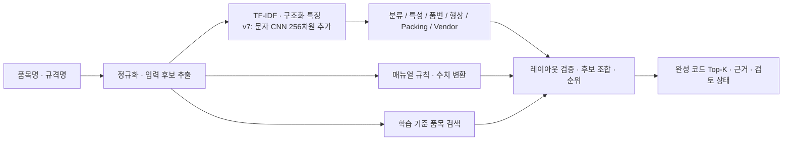
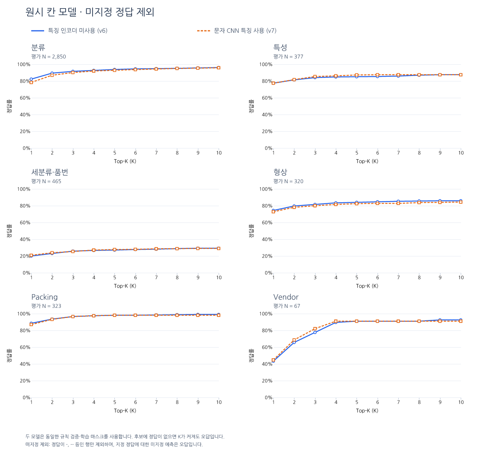

# ERP 원재료 품목코드 생성

품목명과 규격명에서 **완성 품목코드 Top-K 후보**를 만들고, CSV의 빈 품목코드를 채우는 서비스입니다. 내부에서는 분류·특성·세분류/품번·형상·Packing·Vendor를 각각 예측하고, 매뉴얼의 품목별 구조와 수치 규칙, 학습 데이터 기반 검색 결과를 함께 사용해 코드를 조합합니다.

- [공개 웹](https://devopen-gpu.jntp-ax.or.kr/i/OsAdz8rQR7JSXeW6/)
- [소스 저장소](https://github.com/wodoa44-dot/hackerton_10)
- [항목별 Top-K 표](artifacts/reports/encoder_topk/topk_summary.csv)
- [K=1~10 전체 지표](artifacts/reports/encoder_topk/topk_by_slot.csv)
- [미지정 제외 비교 그래프](artifacts/reports/encoder_topk/figures/raw_designated.png)
- [HTML 리포트](artifacts/reports/encoder_topk/report.html): 내려받아 브라우저로 열면 내장된 표와 그래프를 볼 수 있습니다.

## 현재 보관·검증 상태

| 구분 | 상태 |
|---|---|
| 이 저장소와 프로젝트 서버 /data/main | generation_v7 / 7.0-char-cnn-augmented. 사용자가 보존 대상으로 선택한 모델 |
| 현재 공개 웹 | 별도 GPU 학습 서버의 8.0-rule-balanced |
| 이번 정리 | 48개 Python 모듈을 기능별 폴더로 이동, 학습 보조 실행 코드도 training으로 이동, 공통 run.py 추가 |
| 모델 파일 | v7의 작업 모델·공통 처리·내장 CNN을 보관. 필수 19개 파일 해시 재확인 |
| 정리된 과거 모델 | v6 가중치와 독립 encoder_v7 중복 가중치는 삭제. 과거 평가·학습 감사는 보존 |
| v8 전체 백엔드·가중치 | 이 저장소로 아직 동기화하지 못함. 평가 자료와 웹 클라이언트 사본만 보관 |
| 실제 실행 검증 | 구조·호환 경로 테스트 8개, 규칙 Node 브리지, run.py check, run.py report |
| 검증 한계 | 현재 연결된 프로젝트 서버에는 전체 ML 실행 환경이 없어, 이번 구조 변경 후 웹 모델 추론·재학습은 재실행하지 않음. 공개 웹의 기존 v8 API 응답은 별도로 확인 |

이번 소스 정리로 현재 공개 웹 프로세스가 새 구조로 재배포된 것은 아닙니다. 아래 실행 방법은 **저장소의 v7 모델** 기준입니다. v8 웹 사본을 완전한 v8 배포 소스로 간주하면 안 됩니다.

## 서비스 사용 흐름

1. 웹에서 품목명·규격명을 입력하고 완성 코드와 Top-K 후보를 확인합니다.
2. 등록된 학습 기준 품목과 일치하면 등록 코드와 근거를 제시합니다. 새로운 입력은 모델·검색·규칙으로 후보를 생성합니다.
3. 검토 상태와 자동 확정을 구분합니다. 후보의 상대 순위 점수는 정답 확률이 아닙니다.
4. CSV를 올리면 빈 품목코드를 채우고 결과를 내려받습니다. 기존 코드는 원문대로 보존합니다.
5. API와 결과 CSV에는 내부 여섯 작업의 값과 코드 파트 정보를 함께 담을 수 있습니다.

## 폴더 구조

기능 구현은 아래 폴더에 모았습니다. 루트의 **run.py 하나**에서 웹·예측·학습·평가·리포트를 실행합니다.

```
run.py                          공통 실행 진입점
erp_model/
  cli.py                        명령 선택과 단계 실행
  encoders/
    preprocess.py               문자·단위·구분자 정규화와 입력 근거 추출
    candidates.py               입력에서 품번·수치·형상 후보 추출
    features.py                 TF-IDF·구조화 특징, 선택적 CNN 벡터 결합
    numeric_inputs.py           입력 수치 읽기
    rules/                      매뉴얼 코드 해석·품목군·허용값·수치 변환
      company_schema.py         코드 구간 해석과 라벨 유효성
      company_bridge.cjs        Python과 Node 규칙 엔진 연결
      company_engine.js         품목별 후보 생성·조합 규칙
    cnn/                        학습형 문자 CNN
      network.py                바이트 토크나이저·CNN·보조 학습 헤드
      runtime.py                학습된 표현 로드와 입력 벡터 생성
  models/
    tabular.py                  XGBoost·LightGBM·Forest·품번 랭커
    attributes.py               공통 속성 및 품목 라우터
    family.py                   품목군 보조 모델
    lookup.py                   기존 품목 검색
    registry.py                 학습 기준 등록 코드와 출처
  training/
    data/                       학습 CSV 검증·라벨 마스크·공통 폴드
    train_comparison_baseline.py 규칙 감사 라벨로 기준 v6 학습
    train_encoder.py            문자 CNN 학습
    train_encoder_augmented.py  CNN 벡터 추가 후 트리 재학습
    train_generation.py         코드 생성 모델 학습
    train_attributes.py         공통 속성·라우터 학습
    run_encoder_comparison.py   비교 학습의 단계별 실행·로그
    assemble_generation_v6.py   기준 모델 배포 묶음 구성
  prediction/                   칸별 예측·수치 해석·검색·후보 조합
  evaluation/                   완성 코드·칸별·인코더 비교 평가
    report/                     CSV·표·PNG·SVG·HTML 생성 코드와 의존성
  api/                          HTTP API와 비동기 CSV 작업
  web/                          웹 HTML·CSS·JavaScript
  shared/                       공통 스키마·경로·배포 모델 선택·진단
  _compat.py                    과거 import와 저장 모델 모듈 경로 호환
config/                         매뉴얼 기반 코드표와 출처
dataset/                        원재료 학습·추론·전체 CSV
artifacts/
  active_generation.json        저장소 실행 모델 선택: generation_v7
  generation_v7/                실행에 필요한 v7 모델·설정·내장 인코더
  encoder_training_data/        규칙 감사·라벨·학습 행·폴드 기록
  encoder_comparison/           기존 v6/v7 행별 예측과 비교 결과
  balance_comparison/           별도 v6/v8 가중치 비교 자료
  reports/encoder_topk/          이번에 생성한 집계·표·그림·리포트
    private/predictions/        서버 전용 행별 결과 CSV 7개
deploy/manage_web.py             백그라운드 웹 프로세스 관리
examples/demo_input.csv          공개용 더미 입력
tests/                          계약·구조·학습/평가 테스트
recovery/                       복구 이력·소스 이동표·검증 기록
```

기존 import 이름과 joblib/pickle의 모듈 이름을 위한 호환 계층을 포함합니다. 실제 구현은 기능 폴더에 있으며, 예전 경로를 위해 코드를 중복 복사하지 않습니다. 최초 복구 당시의 RECOVERY_MANIFEST.json은 현재 소스 해시 목록이 아닙니다.

## 기존 모델로 실행

모델 실행에는 **Python 3.12 이상**과 Node.js가 필요합니다. NumPy 2.5.4의 Python 요구 조건이 3.12 이상입니다. 보고서 생성·구조 점검에 사용한 최소 환경은 Python 3.11.2와 Node 24.22.2이며, 이 환경에 전체 ML 의존성을 설치한 것은 아닙니다.

저장소의 requirements.txt는 학습 환경에서 기록한 버전입니다. v7은 CNN 특징을 사용하므로 requirements-encoder.txt의 PyTorch도 필요합니다. CPU 추론 환경의 설치 예시는 다음과 같습니다.

```sh
git clone https://github.com/wodoa44-dot/hackerton_10.git
cd hackerton_10
python3.12 -m venv .venv
. .venv/bin/activate
python -m pip install -r requirements.txt
python -m pip install --index-url https://download.pytorch.org/whl/cpu -r requirements-encoder.txt
python run.py check
python run.py
```

기본 실행은 선택된 모델로 8501 포트의 웹/API를 시작합니다. 접속 주소는 http://127.0.0.1:8501 입니다. 특정 모델과 접속 경로는 다음처럼 지정합니다.

```sh
python run.py web --models artifacts/generation_v7 --host 0.0.0.0 --port 8501
python run.py web --models artifacts/generation_v7 --port 8501 --root-path /i/OsAdz8rQR7JSXeW6
```

두 번째 명령의 접두사는 해당 경로를 연결해 주는 배포 환경에서 사용합니다. Node.js도 실행 PATH에 있어야 합니다. v7의 가중치 파일은 Git에 포함되어 있으며 별도의 모델 다운로드가 필요하지 않습니다. v6 가중치는 정리되어 있어 과거 인코더 유무 비교를 모델에서 다시 추론하려면 먼저 기준 모델을 재학습해야 합니다.

```sh
python run.py predict --name DEMO_DIODE --spec "DEMO 100V" --models artifacts/generation_v7
python run.py manage-web start --port 8501
python run.py manage-web status
python run.py manage-web stop
```

manage-web은 프로젝트 .venv의 Python을 사용하고 artifacts/web.log에 로그를 남깁니다. 기본 전경 실행과 별도로 프로세스를 유지할 때 사용합니다. 설치와 신규 웹 기동 명령은 현재 연결된 경량 프로젝트 서버에서 실행 검증하지 못했습니다.

## CSV와 API

CSV의 필수 열은 품목명입니다. 규격명·품목코드는 선택 열입니다. 이름 별칭 item_name/name, 규격 별칭 spec/specification, 코드 별칭 item_code/code도 지원합니다.

- UTF-8/BOM 또는 CP949, 쉼표·세미콜론·탭 구분을 읽습니다.
- 품목코드 열이 없으면 새로 만듭니다. 공백 코드만 예측으로 채웁니다.
- 기존 값·열을 보존하고 처리 상태·검토 필요·예측 파트·후보 코드 열을 추가합니다.
- 규칙 확인이 부족한 추정 채움은 추정채움·규칙미검증으로 구분합니다.
- 빈 품목명·후보 없음·행별 오류는 결과에 상태로 남습니다.
- 파일당 20MB, 30,000행까지 처리하며 결과는 UTF-8 BOM CSV입니다.
- 업로드를 학습에 사용하지 않습니다. 작업 파일은 선택 모델의 batch_jobs 아래에 저장됩니다.

공개용 예시는 examples/demo_input.csv의 더미 품목입니다. 샘플의 기존 코드 DEMO_EXISTING_CODE는 보존 동작을 보이기 위한 문자열이며 실제 ERP 코드가 아닙니다.

```sh
curl -N http://127.0.0.1:8501/predict \
  -H "Content-Type: application/json" \
  --data '{"name":"DEMO_DIODE","spec":"DEMO 100V","candidate_limit":5}'

curl http://127.0.0.1:8501/batch-csv \
  -H "Content-Type: text/csv" \
  -H "X-Filename: demo_input.csv" \
  --data-binary @examples/demo_input.csv
```

POST /predict는 여섯 작업과 완성 코드의 이벤트를 NDJSON으로 반환합니다. CSV 업로드 응답의 id로 GET /batch-csv/{id}에서 상태를, GET /batch-csv/{id}/download에서 결과를 받습니다. GET /health와 GET /model-info는 버전과 평가 정보를 제공합니다.

## 아키텍처와 선택 모델

규칙 검증 인코더와 학습형 CNN은 다른 단계입니다. 학습 전에는 매뉴얼과 실제 코드로 구간을 해석하고, 품목군 불일치·정답 충돌·수치 충돌을 점검해 유효한 칸별 라벨을 만듭니다. 품목코드는 정답·마스크·등록 코드 근거이며, 입력 특징 X는 품목명과 규격명에서 만듭니다.

추론에서는 정규화·후보 추출 뒤 TF-IDF/구조화 특징과 v7의 CNN 벡터를 사용합니다. 문자 CNN은 품목명·규격명의 표기 변형을 표현하기 위한 선택적 학습 특징이며 Transformer나 외부 사전학습 모델 다운로드를 사용하지 않습니다.



| v7의 작업 | 실제 선택 모델 | 역할 |
|---|---|---|
| 분류 | Random Forest | 실제 코드 분류값 예측 |
| 특성 | XGBoost | 품목별 특성 라벨 |
| 세분류·품번 | XGBoost Ranker + LightGBM Ranker 평균 순위 | 입력에서 추출한 품번 후보 순위화 |
| 형상 | XGBoost | Case 구간 |
| Packing | Random Forest | 포장 구간 |
| Vendor | XGBoost 0.5 + LightGBM 0.5 | 제조사 또는 코드 체계의 버전 구간 |

모든 칸에 같은 앙상블을 강제하지 않고 학습 단계에서 선택한 모델을 고정합니다. 품번은 입력 후보의 순위를 학습하고, 저항·용량 등의 숫자 코드는 규칙 변환도 사용합니다. 등록 품목 검색, 속성 모델과 라우터, 품목별 코드 길이·허용값 검증을 거치므로 **최종 코드는 여섯 모델의 Top-1을 단순 연결한 결과와 다를 수 있습니다.**

## 재학습과 모델 평가

GPU 학습은 서버의 CUDA에 맞는 PyTorch를 준비한 환경에서 실행합니다. 아래는 실제 스크립트 인자에 맞춘 단계이며 이번 폴더 정리에서 재학습을 다시 실행한 것은 아닙니다.

```sh
python run.py prepare
ERP_XGB_DEVICE=cuda python run.py train baseline
python run.py train encoder --epochs 24 --batch-size 64 --cpu-threads 2 --max-gpu-memory-gib 8
python run.py train augmented --device cuda --batch-size 64
python run.py evaluate encoder --no-encoder artifacts/generation_v6 --encoder artifacts/generation_v7
python run.py report
```

prepare는 기본 dataset의 training/inference CSV로 공통 감사·학습 마스크와 폴드를 준비합니다. baseline은 동일한 감사 라벨로 기준 모델을 구성하고, augmented는 같은 모델 종류·트리 설정·앙상블을 고정한 채 CNN 벡터를 추가해 맞춥니다. 학습 스크립트는 단계별 기본 산출물 경로를 사용하므로 기존 결과를 보존할 비교 실험은 새 작업 복제본에서 실행합니다.

학습 CSV 11,399행에서 inference와 입력이 겹치는 563행과 비코드 2행을 제외한 10,834행을 유지한 비교입니다. inference 정답은 CNN epoch·트리·가중치 선택에 사용하지 않았습니다. 이 데이터는 이전에 확인한 진단 데이터이므로 미사용 블라인드 시험으로 부르지 않습니다. CNN 추가 트리의 새 OOF 성능이나 보정 확률을 주장하지 않습니다.

## 저장된 결과로 표·그래프 만들기

이 단계는 모델이나 GPU 없이 저장된 예측을 다시 채점합니다. Node 보고서 도구를 한 번 준비한 뒤 같은 run.py에서 실행합니다.

```sh
npm ci --prefix erp_model/evaluation/report --omit=dev --no-audit --no-fund
python run.py report --input artifacts/encoder_comparison --out artifacts/reports/encoder_topk
```

현재 프로젝트 서버에서 검증한 명령:

```sh
/data/tools/bin/python /data/main/run.py check
/data/tools/bin/python /data/main/run.py report --runtime /data/tools/report-runtime
```

생성 파일:

| 파일 | 내용 |
|---|---|
| topk_by_slot.csv | 6항목 × 2모델 × 3관점 × 2모집단 × K=1~10의 720행 |
| topk_summary.csv | Top-1·3·5·10 비교와 인코더 추가 시 변화량 |
| paired_topk_changes.csv | 두 모델 모두 정답 / 한쪽만 정답 / 모두 오답 |
| topk_by_component.csv | 정답 분류코드별 세부 항목 점수와 N |
| whole_code_topk.csv | 전체·매뉴얼 해석 가능·미해석 완성 코드 지표 |
| figures/ | 표·그래프 23개의 PNG/SVG와 재생성용 Vega 명세 |
| report.html | 인터넷 없이 볼 수 있는 표·그래프 통합 보고서 |
| run_manifest.json | 입력·출력 해시, 검증 수, 분모, 환경과 실행 기록 |
| private/predictions/whole_codes.csv | 서버의 행별 완성 코드 결과 5,700행 |
| private/predictions/{항목}.csv | 서버의 여섯 항목별 결과, 각 5,700행 |

집계 CSV·그림·코드는 Git에 보관하고, 새로 생성한 행별 상세 CSV는 서버 전용 private 폴더에 둡니다. 공개 예시에는 더미 입력을 사용합니다.



## 평가 기준과 한계

Top-K 정답률은 **처음 K개 후보 안에 기록된 정답이 있는 행 수 / 같은 평가 행 수 N**입니다. 후보가 없거나 K개 미만인 행도 분모에서 빼지 않습니다.

- 원시 칸 모델: 독립 모델 후보 Top-10에서 직접 재채점합니다.
- 규칙 반영 칸별 후보: 기존 평가에 저장된 칸별 후보 집계를 사용합니다. 행별 후보가 없는 미지정 제외 지표는 빈 값으로 둡니다.
- 완성 코드 칸: 완성 코드 후보에서 해석한 해당 칸의 적중률입니다. 미지정 제외로 행 집합이 달라지면 기록된 K=1·3·5·10을 재계산합니다. 행 집합이 같으면 기존 K=1~10 집계를 그대로 사용할 수 있습니다.
- 완성 코드 전체: ERP 정답 코드와 완전일치하는 후보를 채점합니다. 의미상 가능한 다른 코드 전체를 정답으로 인정한 지표는 아닙니다.
- 미지정 제외: 정답이 -, -- 등인 행만 제외합니다. 지정된 정답에 대한 미지정 예측은 오답입니다.

| 원시 칸 모델 · 미지정 제외 Top-1 | 미사용 v6 | CNN v7 | N |
|---|---:|---:|---:|
| 분류 | 82.32% | 78.35% | 2,850 |
| 특성 | 77.45% | 77.45% | 377 |
| 품번 | 20.00% | 20.86% | 465 |
| 형상 | 74.38% | 72.81% | 320 |
| Packing | 88.54% | 87.00% | 323 |
| Vendor 구간 | 43.28% | 44.78% | 67 |

품번 원시 지표에는 숫자형·문자형이 함께 들어가므로 순수 문자 품번 랭커 정확도와 다릅니다. Vendor 구간에는 제조사와 일부 버전 구간이 섞여 있습니다. 학습 표본이 적거나 학습에서 보지 못한 라벨, 입력 후보에서 정답 품번이 빠진 사례, 매뉴얼과 기존 ERP 코드의 차이가 성능을 제한합니다.

완성 코드 v7 Top-1은 전체 **277/2,850 = 9.72%**, 매뉴얼 해석 가능 범위 **277/473 = 58.56%**입니다. Top-10은 각각 **350/2,850 = 12.28%**, **325/473 = 68.71%**입니다. 상세 칸의 높은 점수를 전체 코드 정확도로 해석하면 안 됩니다. 규칙 범위 밖 2,377행은 상세 라벨을 임의로 만들지 않고 완성 코드 전체 분모에 남깁니다.

v6 실행 가중치는 현재 정리된 상태이지만 기록된 행별 후보가 있어 이번 표·그래프를 다시 만들 수 있습니다. v8 클래스 가중치 실험은 artifacts/balance_comparison의 별도 실험이며 이 인코더 유무 그래프에 섞지 않았습니다.

## 이번 검증 기록

- 구조·모듈 호환 테스트 8개 통과: tests/test_layout_compat.py
- Python 67개 파일 문법, 내부 import 경로, 47개 이전 경로, 예전 pickle GLOBAL 참조 점검
- v7 필수 19개 파일 해시 및 이동한 Node 규칙 엔진의 실제 요청·응답 확인
- 행별 후보·저장 집계·동일 평가 행 집합에 대한 154,548개 확인
- 보고서 명령 약 4초, 최대 메모리 약 0.5GiB, PNG/SVG 표·그림 23개 생성
- 새로운 웹 모델 추론·전체 의존성 설치·GPU 재학습은 이번 연결 서버에서 미실행

구조 기록은 recovery/grouped_layout_verified.json, 보고서 근거는 artifacts/reports/encoder_topk/run_manifest.json에 있습니다. 원본 복구 이력은 RECOVERY.md와 recovery에 남깁니다.
